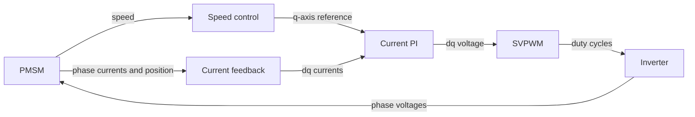

# PMSM simulator architecture

The simulator combines a continuous motor plant with digital blocks that run
at configured rates. A JSON file defines the block instances, signal
connections, and CSV columns. See the [assembly guide](README.assembly.md)
for instructions on editing the model.

## Startup and ownership

| File | Responsibility |
| --- | --- |
| [`main.cpp`](main.cpp) | Loads the config, constructs the drive, and registers the CSV logger. |
| [`configuration.h`](configuration.h) | Reads simulation settings and block specifications. Converts digital rates in Hz to integer nanosecond periods. |
| [`drive.h`](drive.h) | Constructs the configured model. Owns block instances and the executor and binds callbacks at startup. |
| [`block_catalog.cpp`](block_catalog.cpp) | Lists the block types available to JSON configs and maps each type name to its factory. |
| [`block_ports.h`](block_ports.h) | Defines the shared typed input port and signal quantities used by components. |
| [`block_graph.h`](block_graph.h) | Uses C++26 reflection to discover named ports, validate connections, and resolve CSV readers. |
| [`blocks/`](blocks/) | Defines each component's equations, connectable wrapper, and reflected ports in its own header. |
| [`simulation_executor.h`](simulation_executor.h) | Advances simulation time and dispatches the continuous and digital callbacks. |

The graph's name maps exist during drive construction. Once validation
succeeds, each input holds a typed pointer to its source value. CSV readers
also retain the addresses they resolve at startup. Blocks publish values into
their own output storage, so a consumer sees the latest published value when
it reads its input. Each block owns its internal state.

The executor stores callbacks in a fixed-capacity array. A delegate holds an
object pointer and a dispatch function pointer. Binding and calling these
delegates requires no heap allocation. The drive owns the block instances
for the duration of the run, and the logger stays alive through the run.

## Signal flow

The default config closes a speed loop around a current loop. The motor
also supplies rotor position to current feedback and SVPWM, and mechanical
speed to the PI for feedforward.

## Simulation time and integration

1. The motor publishes its initial outputs during construction. All periodic
   callbacks are first due at simulated time zero.
2. At each timestamp, the executor runs due callbacks in ascending priority,
   using registration order for ties. With the default config, coincident
   ticks run speed control, feedback, current PI, SVPWM, inverter, then CSV
   logging.
3. The executor selects the next timestamp from the maximum integration step,
   the next scheduled callback, and the end time. It calls the motor's
   `advance(dt)` for that interval and then moves its simulation clock forward.
   The clock advances from model events and steps without consulting wall time.
4. The motor reads its phase-voltage inputs once per interval.
   [`ContinuousPmsm`](blocks/continuous_pmsm.h) runs the four RK4 stages with
   those held voltages and commits the accepted state. It computes phase
   currents, speed, and position before the next digital callbacks run.

[`PmsmPlant`](blocks/plant.h) provides the motor equations. The digital
current PI advances its own integrators once per current tick. SVPWM and the
averaged inverter publish duty cycles and voltages that remain available
until their next ticks.

## Results

The CSV logger reads the configured ports on its own clock. It records
`time_s` from the executor, then the latest values of the selected inputs
and outputs. It samples at zero and at the final time, including a final row
when the end falls between logging ticks. The
[Plotly notebook](plot_pmsm_results.ipynb) reads the generated CSV for analysis.
